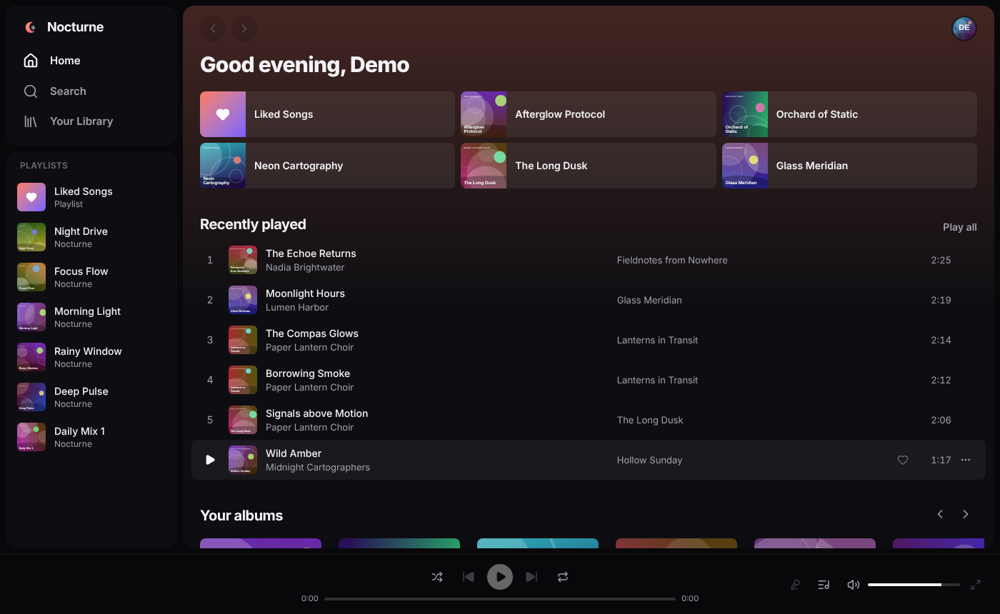
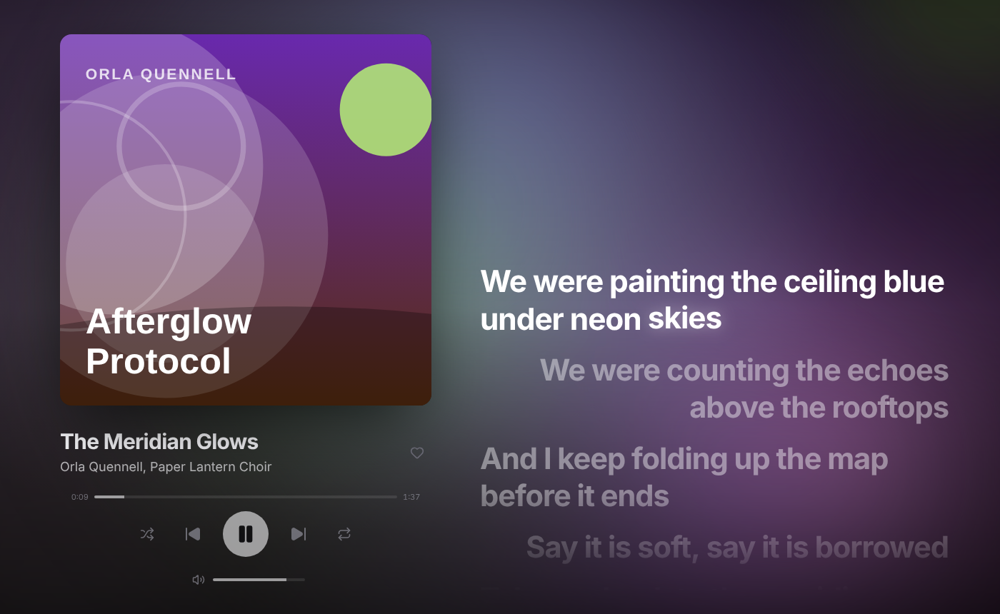
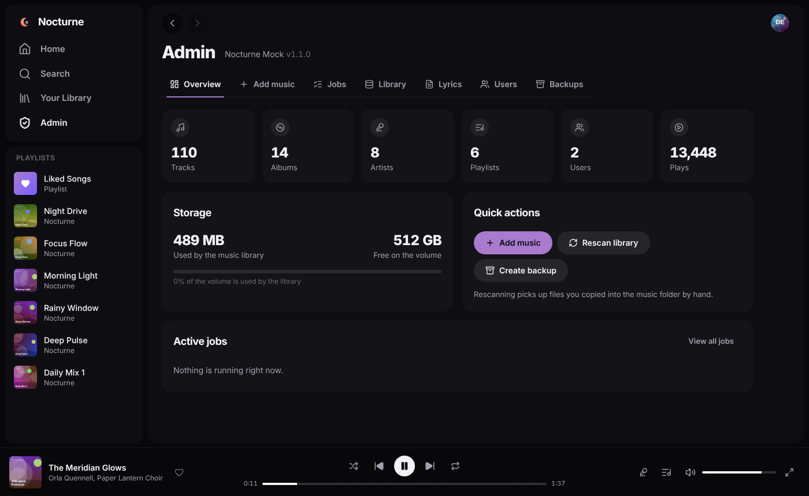

# Nocturne

**A self-hosted music server with clean, ad-free client apps.** Run the server on your own
machine with Docker, put your music in a folder, and listen from the browser, Windows/Linux
desktop or Android, with synced lyrics, themes and remote control between your devices.

No ads, no tracking, no analytics. The only third party the player talks to is
[LRCLIB](https://lrclib.net) (synced lyrics), and only with the title, artist, album and
duration of the song that is playing.

> ¿Hablas español? Ve a la [sección en español](#español).

## Screenshots

| Home | Lyrics | Admin |
| --- | --- | --- |
|  |  |  |

<!-- More in app/docs/screenshots/. Replace/add screenshots here. -->

## Features

- **Your library**: songs, albums, artists, playlists and liked songs, with a home page of
  recently added, most played, never played and recently played sections built by the server. Gapless playback, optional crossfade,
  queue with drag-to-reorder, shuffle and repeat.
- **Search** across songs, albums, artists and playlists.
- **Lyrics**: line- and word-synced lyrics (LRCLIB, server-side lyrics, admin-uploaded TTML/LRC),
  plus **lyric cards**: share a few lines as an image in post or Instagram **story** format.
- **Themes**: Dark, **OLED** (true black), **Adaptive** (follows the artwork colors), Dim,
  Midnight, Dracula, Nord, Tokyo Night, Catppuccin, Rosé Pine, Gruvbox, with accent colors and
  fullscreen audio-reactive visualizers.
- **Nocturne Connect**: see your other devices (browser, desktop, phone) and control playback on
  any of them from any other.
- **Apps**: hosted web app served by the server itself, **Android** (Capacitor) and
  **Windows/Linux** (Electron) apps with media keys, lock-screen and notification controls.
- **In-app updates** with **stable** and **beta** channels (fed by your server).
- **Admin panel** (users with the `admin` role): add music from Spotify or YouTube, upload files,
  import playlists, edit the library and lyrics, manage users and backups, follow background jobs.
- **Secure by default**: short-lived JWT access tokens + rotating refresh tokens (HttpOnly cookie on
  the web), Argon2 password hashing, signed media URLs, strict CSP, rate limiting, and the old
  unauthenticated NOVA endpoints disabled.

## Quick start with Docker

Requirements: Docker with the Compose plugin.

```bash
git clone https://github.com/AlexproXD006/nocturne.git nocturne && cd nocturne
cp .env.example .env

# Generate the two required secrets (they must be different):
sed -i "s/^NOCTURNE_JWT_SECRET=.*/NOCTURNE_JWT_SECRET=$(openssl rand -hex 32)/" .env
sed -i "s/^NOCTURNE_MEDIA_SECRET=.*/NOCTURNE_MEDIA_SECRET=$(openssl rand -hex 32)/" .env

# Edit .env: set NOCTURNE_ADMIN_PASS (10+ chars), NOCTURNE_PUBLIC_URL, MUSIC_PATH ...
nano .env

mkdir -p music && sudo chown -R 10001:10001 music   # the container runs as uid 10001
docker compose up -d
docker compose logs -f nocturne
```

Open `http://localhost:8000` (or your `NOCTURNE_PUBLIC_URL`) and sign in with the admin account.
Then remove `NOCTURNE_ADMIN_USER`/`NOCTURNE_ADMIN_PASS` from `.env`.

- **Prebuilt image**: instead of building locally, set `NOCTURNE_IMAGE=ghcr.io/alexproxd006/nocturne:latest`
  in `.env` (images for `linux/amd64` and `linux/arm64` are published by
  [`.github/workflows/docker.yml`](.github/workflows/docker.yml)).
- **Existing music**: point `MUSIC_PATH` at your music folder. Files copied there by hand are picked
  up on startup or with *Admin → Rescan library*. The databases (`library.db`, `nocturne.db`) and
  Nocturne's data also live in that folder, so back it up.
- **HTTPS**: put the container behind a reverse proxy (Caddy, Traefik, nginx, Nginx Proxy Manager)
  on a single origin, forward everything to port 8000, set `NOCTURNE_PUBLIC_URL=https://your.domain`
  and `NOCTURNE_TRUSTED_PROXIES` to the proxy's IP. The Android and desktop apps require HTTPS
  except for LAN addresses.
- **Create users / reset passwords** from the admin panel, or the CLI:
  `docker compose exec nocturne python -m nocturne_api.cli create-admin <user> <password>`
  (`list-users`, `reset-password <user> <password>`).
- **Local lyric timing with Whisper** (optional, bigger image):
  `docker compose build --build-arg WITH_WHISPER=true`.
- **Upgrading**: `git pull && docker compose up -d --build` (or `docker compose pull && docker compose up -d`
  with a prebuilt image). Database migrations run automatically on startup.

The server must run with **one** uvicorn worker (the image does): Nocturne Connect keeps its live
event streams in process memory.

## Configuration

All settings are environment variables; [`.env.example`](.env.example) documents every one.

| Variable | Default | Purpose |
| --- | --- | --- |
| `NOCTURNE_JWT_SECRET` | **required** | Signs access/refresh tokens. ≥ 32 chars (`openssl rand -hex 32`). |
| `NOCTURNE_MEDIA_SECRET` | **required** | Signs stream/artwork URLs. ≥ 32 chars, different from the JWT secret. |
| `NOCTURNE_ADMIN_USER` / `NOCTURNE_ADMIN_PASS` | – | First admin, created only when no account exists. Password ≥ 10 chars. |
| `NOCTURNE_PUBLIC_URL` | `http://localhost:8000` | Address clients use. Absolute media URLs, CSRF origin, `Secure` cookies when `https://`. |
| `NOCTURNE_CORS_ORIGINS` | `app://nocturne,https://localhost,capacitor://localhost,http://localhost:5173` | Origins allowed to call `/v1` cross-origin (desktop, Android, dev server). |
| `NOCTURNE_TRUSTED_PROXIES` | – | Proxy IPs whose `X-Forwarded-For` is trusted (rate limiting). |
| `NOCTURNE_HSTS` | `true` | Send `Strict-Transport-Security` on web responses. |
| `NOCTURNE_UPLOAD_MAX_MB` | `200` | Max size of one uploaded file. |
| `SPOTIPY_CLIENT_ID` / `SPOTIPY_CLIENT_SECRET` | – | Spotify API credentials for downloads/metadata (optional). |
| `SPOTIFY_CLIENT_ID` / `SPOTIFY_CLIENT_SECRET` | – | Same values; makes `/v1/info` advertise Spotify as a source. |
| `AUDIO_FORMAT` | `opus` | Format for new downloads (`opus`, `mp3`, `m4a`, `flac`, `wav`). |
| `OLLAMA_BASE_URL` | `http://localhost:11434` | Optional Ollama server to time plain lyrics. Skipped if unreachable. |
| `WHISPER_MODEL` / `WHISPER_DEVICE` / `WHISPER_COMPUTE_TYPE` | `small` / `auto` / `auto` | faster-whisper settings (image built with `WITH_WHISPER=true`). |
| `MUSIC_DIR` | image: `/music` (code: `./music`) | Music library; also holds `library.db`. |
| `NOCTURNE_DB_PATH` | `<MUSIC_DIR>/nocturne.db` | Nocturne accounts/tokens/likes database. |
| `NOCTURNE_DATA_DIR` | `<MUSIC_DIR>/.nocturne_data` | Nocturne data (artwork cache). |
| `NOCTURNE_WEB_DIR` | image: `/app/web` (code: `/opt/nocturne/web`) | Hosted web app served at `/`. |
| `NOCTURNE_DOWNLOADS_DIR` | image: `/downloads` (code: `/opt/nocturne/downloads`) | App downloads (`/nocturne.apk`, `/nocturne-beta.apk`, `/nocturne-windows-x64.zip`, `/descargar`) and the in-app update feed `latest.json`. |
| `NOVA_LEGACY_API` | `off` | Legacy unauthenticated NOVA API (`/api/*`, `/ws/*`, `/docs`): `off`, `internal` (loopback only) or `on`. |
| `NOCTURNE_ANDROID_KEYSTORE` / `NOCTURNE_ANDROID_KEY_ALIAS` / `NOCTURNE_ANDROID_KEYSTORE_PASS` | – / `nocturne` / – | Optional: lets an admin download a backup of your Android signing keystore. |

### In-app updates

The apps ask `GET /v1/updates/{android|android-beta|windows|desktop}`, which reads
`<NOCTURNE_DOWNLOADS_DIR>/latest.json`:

```json
{
  "android":      { "version": "1.0.4", "url": "/nocturne.apk", "sha256": "…", "notes": "" },
  "android-beta": { "version": "1.0.5-beta.1", "url": "/nocturne-beta.apk", "sha256": "…", "notes": "" },
  "windows":      { "version": "1.0.4", "url": "/nocturne-windows-x64.zip", "sha256": "…", "notes": "" }
}
```

Mount a folder with that file and the builds at `/downloads` (see `docker-compose.yml`). Without it the
feed answers `503` and the apps simply report that no update information is available.

## Building the apps

The client lives in [`app/`](app/) (React + Vite + TypeScript, Electron for desktop, Capacitor for
Android). See [`app/README.md`](app/README.md) for development (`npm run dev`, a mock server with demo
data), the hosted web build, Windows/Linux installers, Android APK signing and the API contract
([`app/docs/API.md`](app/docs/API.md)). Requires Node 22.

```bash
cd app
npm ci
npm run dev            # desktop app in dev mode (use `npm run mock` for a demo server)
npm run build:hosted   # the web app the server serves (what the Docker image does)
npm run dist:win       # Windows installer
npm run android:apk    # Android APK (needs the Android SDK; signing via NOCTURNE_KEYSTORE* env)
```

CI ([`.github/workflows/ci.yml`](.github/workflows/ci.yml)) runs the app typecheck/tests and the server
tests; [`apps.yml`](.github/workflows/apps.yml) packages desktop installers and the APK and attaches them
to a GitHub Release on `v*` tags.

## Running the server without Docker

```bash
cd server
python3.13 -m venv venv && . venv/bin/activate
pip install -r requirements.txt          # + requirements-whisper.txt (optional), requirements-dev.txt (tests)
# ffmpeg must be installed (apt install ffmpeg)
export NOCTURNE_JWT_SECRET=$(openssl rand -hex 32) NOCTURNE_MEDIA_SECRET=$(openssl rand -hex 32)
export MUSIC_DIR=/path/to/music NOCTURNE_WEB_DIR=../app/dist-hosted
cd backend && uvicorn main:app --host 0.0.0.0 --port 8000 --workers 1
```

Tests: `cd server && pip install -r requirements-dev.txt && pytest nocturne_api/tests`.

## Project layout

```
.
├── app/                    Nocturne client: React renderer, Electron (desktop), Capacitor (Android)
│   ├── src/                main/ (Electron), preload/, renderer/ (React UI)
│   ├── android/            Android project (Capacitor)
│   ├── mock-server/        Zero-dependency demo server implementing /v1
│   ├── docs/               API contract, architecture, security, deployment notes
│   └── tests/              Vitest suites
├── server/                 Music server (Python 3.13, FastAPI)
│   ├── backend/            NOVA engine: library DB, scanner, Spotify/YouTube downloader, lyrics, radio
│   │   └── main.py         ASGI entry point (uvicorn main:app)
│   ├── nocturne_api/       Nocturne /v1 API: auth, library, media, admin, connect, updates, web hosting
│   │   └── tests/          pytest suite
│   ├── docs/               Legacy NOVA documentation (Spanish)
│   └── requirements*.txt
├── docker/Dockerfile       Multi-stage image: builds the web app, runs the server
├── docker-compose.yml
├── .env.example            Every server setting, documented
└── .github/workflows/      ci.yml, docker.yml (GHCR), apps.yml (installers + APK)
```

## Legal

Nocturne's downloader uses **spotdl** and **yt-dlp**, which fetch audio from YouTube. This may
violate YouTube's Terms of Service, and downloading copyrighted content without permission may be
illegal in your jurisdiction.

- This software is intended for **personal use**. Do not use it to distribute copyrighted content,
  to mass-download protected content, or for any commercial purpose.
- **You** are responsible for complying with your local laws and with the terms of service of the
  platforms you use.
- The Spotify API is used for metadata only. Use your own developer credentials and do not share them.

Nocturne is not affiliated with Spotify, YouTube, LRCLIB or any streaming service.

## License

[MIT](LICENSE) © 2026 Alex

---

## Español

**Nocturne** es un servidor de música autoalojado con apps limpias y sin anuncios: web, Android y
Windows/Linux. Biblioteca, búsqueda, letras sincronizadas (y tarjetas de letras para compartir en
Instagram), temas (incluidos OLED y Adaptativo), **Nocturne Connect** para controlar la reproducción
entre tus dispositivos, actualizaciones dentro de la app con canales estable y beta, y panel de
administración para añadir música (Spotify/YouTube o subida de archivos), usuarios y copias de seguridad.

**Arranque rápido con Docker:**

```bash
cp .env.example .env
# Rellena NOCTURNE_JWT_SECRET y NOCTURNE_MEDIA_SECRET con `openssl rand -hex 32` (distintos),
# NOCTURNE_ADMIN_PASS (10+ caracteres), NOCTURNE_PUBLIC_URL y MUSIC_PATH.
mkdir -p music && sudo chown -R 10001:10001 music
docker compose up -d
```

Abre `http://localhost:8000` e inicia sesión con el usuario administrador. Todas las variables están
explicadas en [`.env.example`](.env.example) y en la tabla de [Configuration](#configuration). Para
HTTPS, pon el contenedor detrás de un proxy inverso y ajusta `NOCTURNE_PUBLIC_URL`.

**Aviso legal:** spotdl y yt-dlp usan YouTube como fuente de audio, lo que puede violar sus Términos de
Servicio; descargar contenido con derechos de autor sin permiso puede ser ilegal en tu país. Úsalo solo
para **uso personal**: no para distribuir contenido protegido, descargas masivas ni fines comerciales.
Eres responsable de cumplir las leyes locales y los términos de las plataformas. Usa tus propias
credenciales de la API de Spotify y no las compartas.
