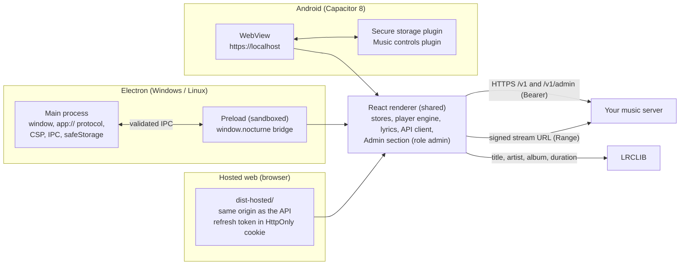
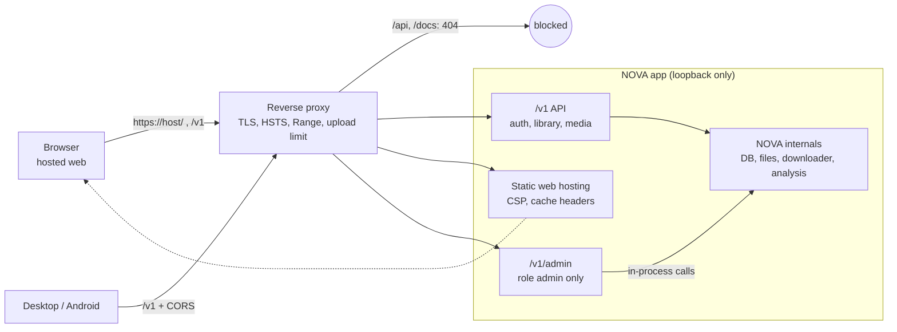
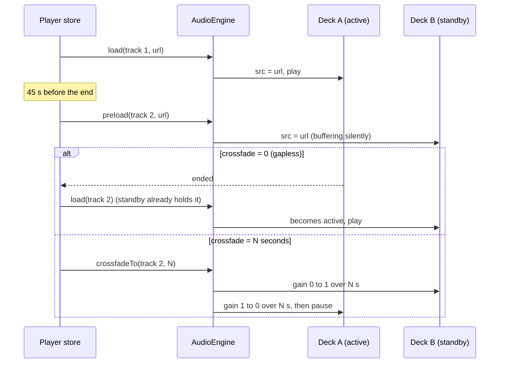
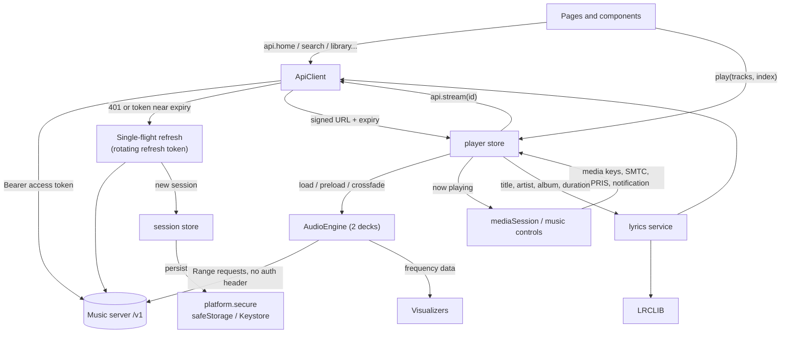

# Architecture

Nocturne is a single React renderer packaged three times: inside Electron for Windows and Linux, inside
a Capacitor WebView for Android, and as a static **hosted web app** served by the music server itself. Everything platform specific sits behind one small interface, so the UI,
player and API client contain no `if (electron)` branches.

## Hosted web target and server side

`npm run build:hosted` (`VITE_HOSTED=true`) builds the same renderer into `dist-hosted/`. In that mode `platform.hostedOrigin === location.origin`,
the login screen has no server field, and the session is a cookie session (`X-Nocturne-Session: cookie`): the refresh token lives in an HttpOnly cookie
and only the access token is held in memory. The server serves the files at `/` with an SPA fallback, and the API at `/v1` on the same origin, so no CORS is involved.

**Admin module (client).** `src/renderer/src/pages/admin/` holds the Admin section (Overview, Add music, Jobs, Library, Users, Backups, Lyrics), reached only when
`session.user.role === 'admin'` and `capabilities.admin` is true. It uses the `admin*` methods of `ApiClient`; long operations return an `AdminJob` that the UI polls every ~1.5 s while any job is queued or running.
**Admin module (server).** `/v1/admin` maps onto NOVA's internal functions: source search and downloads (Spotify, YouTube) become jobs, uploads are validated and ingested, users live in Nocturne's own accounts table, and backups use NOVA's backup logic.
The full table is in [HOSTED_AND_ADMIN.md](HOSTED_AND_ADMIN.md) and the deployment steps in [DEPLOY.md](DEPLOY.md).

## Processes (desktop)

| Process | Source | Responsibility |
| --- | --- | --- |
| Main | `src/main/` | Single-instance lock, frameless window with persisted bounds, the `app://` protocol, CSP, permission handler, navigation lock, IPC handlers, encrypted secret store |
| Preload | `src/preload/index.ts` | Runs sandboxed as one self-contained CommonJS file (`out/preload/index.cjs`). Exposes a frozen, typed `window.nocturne` object via `contextBridge`. Raw `ipcRenderer` is never exposed |
| Renderer | `src/renderer/` | The whole UI. No Node.js, no direct Electron access. Talks to the main process only through `window.nocturne` |

`src/shared/ipc.ts` holds the channel names and the `NocturneBridge` type used by all three, so a channel
cannot drift between sides.

The bridge surface is deliberately tiny:

- `secure.get / set / delete`: encrypted key-value storage for the session tokens.
- `window.minimize / toggleMaximize / close / setFullscreen / onState`: for the custom title bar.
- `app.info / openExternal`: version, whether encryption is available, and opening `http(s)` links in the OS browser.

## The `app://` protocol

The packaged renderer is not loaded from `file://`. `src/main/index.ts` registers a privileged
`app` scheme (standard, secure, fetch and streaming capable) and serves `out/renderer` at `app://nocturne/`.

- `resolveAppAsset` maps a URL to a file under the renderer root and rejects traversal (`..`, NUL bytes, other hosts). Extension-less routes fall back to `index.html` (single page app).
- Responses carry `X-Content-Type-Options: nosniff` and `Cross-Origin-Opener-Policy: same-origin`; HTML responses carry the Content-Security-Policy built by `buildCsp()`.
- The origin `app://nocturne` is what the server must allow in CORS. It is also what `isTrustedRendererUrl` checks before any IPC call is honored.

In development the renderer comes from the electron-vite dev server, with a relaxed CSP applied only to that origin.

## Platform abstraction

`src/renderer/src/platform/index.ts` exports one `platform` object, chosen at startup:

| | Desktop | Android | Web (dev, tests) |
| --- | --- | --- | --- |
| Detection | `window.nocturne` exists | `Capacitor.isNativePlatform()` and platform `android` | fallback; `VITE_HOSTED=true` marks the hosted build |
| Secure storage | IPC to main, `safeStorage` (DPAPI, Keychain, libsecret / kwallet) | `@aparajita/capacitor-secure-storage` (Android Keystore) | `sessionStorage` (cleared with the tab) |
| Now playing | `navigator.mediaSession` (media keys, SMTC, MPRIS) | `mediaSession` (native Media3 notification) | `mediaSession` |
| Window controls | Custom title bar via IPC | none | none |
| Open link | IPC, validated in main | `window.open` with `noopener` | `window.open` with `noopener` |

`useMediaSession` keeps both in sync from the player state: metadata and artwork, playback position,
and the action handlers (play, pause, next, previous, seek). Android notification button presses
come back as `controlsNotification` events and are mapped to the same player actions.

## State

Zustand stores in `src/renderer/src/store/`, created through factories so tests can inject fakes:

| Store | Holds | Persistence |
| --- | --- | --- |
| `session` | Status (`restoring`, `signedOut`, `signedIn`), tokens, server info, last server URL | Tokens in platform secure storage, server URL in `localStorage` |
| `player` | Queue, status, position, duration, volume, errors | Volume and mute via `settings` |
| `settings` | Crossfade, visualizer, motion preference, lyrics on/off, volume | `localStorage`, sanitized on read |
| `ui` | Side panel (queue or lyrics), fullscreen, toasts | none |
| `nav` | In-app history stack (back and forward) | none |
| `likes` | Optimistic overrides on top of each track's `liked` flag | none |

`services.ts` wires the singletons together: the API client reads and writes the session store,
the player store gets the audio engine and `api.stream`, and signing out stops playback.

Queue logic (`player/queue.ts`) is pure: shuffle keeps the original order so turning it off restores it,
and `advance` / `peekNext` implement repeat modes without touching the audio element.

## Audio engine

`player/engine.ts` is a dual-deck engine built on two `HTMLAudioElement`s.

- **Preload.** When the current track is within 45 seconds of its end, the store resolves the next track's stream URL and the engine loads it on the standby deck. Starting it later is instant, which is what makes playback gapless.
- **Crossfade.** Enabled when the setting is greater than zero, the track is longer than twice the fade, and repeat-one is off. The standby deck starts at gain 0 while the active one fades out; gains are linear ramps on Web Audio `GainNode`s (or a 40 ms timer on element volume when no audio graph exists).
- **Micro fades.** Play and pause use a 120 ms fade to avoid clicks.
- **Analyser and the CORS fallback.** For the visualizers each deck feeds `createMediaElementSource` into a gain, a master gain and an `AnalyserNode`. A media element routed through Web Audio is only allowed when the response passes CORS, so the decks set `crossOrigin = "anonymous"`. If the server does not send CORS headers on the audio, the element errors: the engine rebuilds both decks without the analyser, reloads the same track at the same position, and reports `reactive = false`. Playback continues and the visualizers fall back to a plausible synthetic spectrum (`player/analysis.ts`). If plain playback fails as well, it was not a CORS problem and the error is surfaced.
- **Signed URLs.** The store caches each stream URL until 60 seconds before `expiresAt`. If playback errors once for a track (typically an expired URL), the store fetches a fresh URL and resumes at the same position; a second error skips to the next track.
- **Play reporting.** After 30 listened seconds or 50% of the track, `reportPlayed` is sent once (best effort), unless the server declares `capabilities.scrobble: false`.

Artwork is also fetched with CORS, because the accent color extraction draws it onto a canvas.

## Lyrics pipeline

`lyrics/service.ts`, driven by the `useLyrics` hook, with a 100-entry cache keyed by track id:

1. **LRCLIB** (`lyrics/lrclib.ts`): the title is cleaned of noise such as "(feat. X)" and "- Remastered 2011", then `GET /api/get` is tried with title, artist, album and duration; if that misses, `GET /api/search` results are scored (duration within 5 seconds, title and artist match, synced preferred). Requests are serialized, cached in an LRU, and honor `Retry-After` on 429 and 503 once.
2. If LRCLIB has **synced** lyrics, they are used (`lyrics/lrc.ts` parses timestamps, offsets and multiple stamps per line).
3. Otherwise, when the server advertises `capabilities.lyrics`, `GET /v1/tracks/{id}/lyrics` is asked; its `synced` LRC wins over a plain LRCLIB result.
4. Otherwise the best plain text found is shown, or "instrumental", or nothing.

Only title, artist, album and duration leave the device towards LRCLIB. No account or server data is sent.

## Data flow

`ApiClient` details worth knowing: access tokens are refreshed 30 seconds early; concurrent refreshes share one in-flight
request; a 401 triggers one refresh and one retry; idempotent GETs get one retry after a network or 5xx error;
refresh failures with 400, 401 or 403 sign the user out; requests are sent with `credentials: "omit"`
and `cache: "no-store"`, with a timeout (15 s, 8 s for `/v1/info`).

## Build and packaging

- `electron-vite` builds main (`out/main/index.js`), preload (`out/preload/index.cjs`) and renderer (`out/renderer`).
- `vite.web.config.ts` builds the same renderer with relative asset paths into `dist-web/` for Capacitor, and (`npm run build:hosted`, mode `hosted`) into `dist-hosted/` for the server to serve at `/`.
- `electron-builder.yml` packages only `out/**` and `package.json` (plus the window icon) into an ASAR, then flips Electron fuses.
- `scripts/patch-android.mjs` hardens the generated Android project after every `cap add` or `cap sync`.
